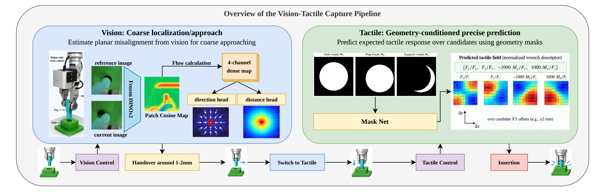
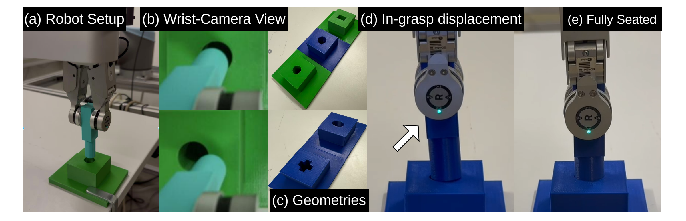

# ReViTa

### Reference-Conditioned Visual–Tactile Inference for Reliable Peg-in-Hole Insertion

Vision-guided coarse alignment and geometry-conditioned tactile refinement for reliable robotic insertion, trained without paired visual–tactile observations.

[Demo video](demo.mp4) · [Abstract](#abstract) · [Pipeline](#pipeline) · [Selected results](#selected-results)

## Demo

**[Watch or download the demonstration video (MP4, approximately 14 MB)](demo.mp4)**

## Abstract

Peg-in-hole insertion requires reliable contact-based refinement after vision-guided coarse alignment. Common approaches rely on blind or heuristic search to improve alignment but face key limitations: e.g., loaded spiral search risks peg slippage within the gripper, whereas dense press–retract search introduces interaction overhead. To address this trade-off, we present ReViTa, a reference-conditioned visual–tactile inference framework that combines vision-based coarse alignment with tactile-based fine correction. The visual module uses spatial relations between frozen DINOv2 patch features from query and reference images to estimate the direction and metric distance to the hole. The tactile module matches measured force/torque to geometry-conditioned predictions and accumulates evidence across contacts to infer corrective motion. Sparse press–retract corrections are used to limit in-grasp displacement. Notably, both visual and tactile branches are trained independently, without requiring paired visual–tactile data collection. In simulated end-to-end trials, ReViTa achieved insertion success rates of 97.8% on training geometries and 95% on held-out geometries. After lightweight affine adaptation of the tactile module, ReViTa succeeded in 38/40 real-world trials (95%) across Rectangle and held-out Ellipse geometries, compared with 9/40 (22.5%) for vision-guided spiral search.

## Pipeline

- **Visual alignment:** spatial relations between frozen DINOv2 patch features from current and reference images predict correction direction and metric distance.
- **Tactile refinement:** a geometry-conditioned forward model predicts contact wrenches; motion-aligned evidence across contacts resolves ambiguous offsets.
- **Sparse correction:** press–retract motions unload contact before lateral movement, limiting displacement of the peg within the grasp.

The visual and tactile branches are trained separately. Hardware transfer uses a lightweight affine adaptation of the tactile module.

## Experimental setup

*UR10 arm, OnRobot RG2-FT gripper with dual-fingertip force/torque sensing, and a wrist-mounted RGB camera. Success requires verified full seating.*

## Selected results

### Real-world end-to-end insertion

Verified seatings / attempts from matched **10–30 mm initial offsets**, with 20 trials per geometry. Rectangle is supervised; Ellipse is held out.

| Geometry | Vision + terminal step | Vision + spiral | ReViTa |
|---|---:|---:|---:|
| Rectangle (supervised) | 0/20 | 4/20 | **20/20** |
| Ellipse (held out) | 0/20 | 5/20 | **18/20** |
| **Total** | **0/40** | **9/40 (22.5%)** | **38/40 (95.0%)** |

ReViTa's 95% Wilson confidence interval is **83.5–98.6%**. Methods share matched starts and a 160 s time limit; hardware contact settings follow their respective control strategies.

### Simulated end-to-end insertion

Verified seatings / attempts from **30 matched starts per geometry**. Cylinder, Rectangle, and Hexagon are supervised; Ellipse and Decagon are held out. Cross is a separate nonconvex stress test and is excluded from the pooled column.

| Method | Cylinder | Rectangle | Hexagon | Ellipse | Decagon | Pooled | Cross (stress) |
|---|---:|---:|---:|---:|---:|---:|---:|
| Vision | 1/30 | 3/30 | 4/30 | 3/30 | 2/30 | 13/150 | 0/30 |
| Vision + terminal step | 11/30 | 8/30 | 5/30 | 6/30 | 10/30 | 40/150 | 0/30 |
| Vision + single refinement | 22/30 | 20/30 | 23/30 | 13/30 | 17/30 | 95/150 | 0/30 |
| Vision + spiral | **29/30** | 28/30 | **29/30** | 28/30 | **28/30** | 142/150 | **29/30** |
| **ReViTa** | **29/30** | **30/30** | **29/30** | **29/30** | **28/30** | **145/150** | 6/30 |

ReViTa achieves **97.8%** success on supervised geometries and **95.0%** on the two held-out transfer geometries. Performance remains limited on the nonconvex Cross geometry and at very tight clearance; the stress-test result is retained above to show the evaluated scope.

## Availability

This repository contains the project abstract, selected figures, reported results, and demonstration video. Source code, trained models, and training data are not publicly released at this time.

Figures and results are reproduced from the project manuscript. This preview does not grant an open-source license to the underlying implementation or research materials.
